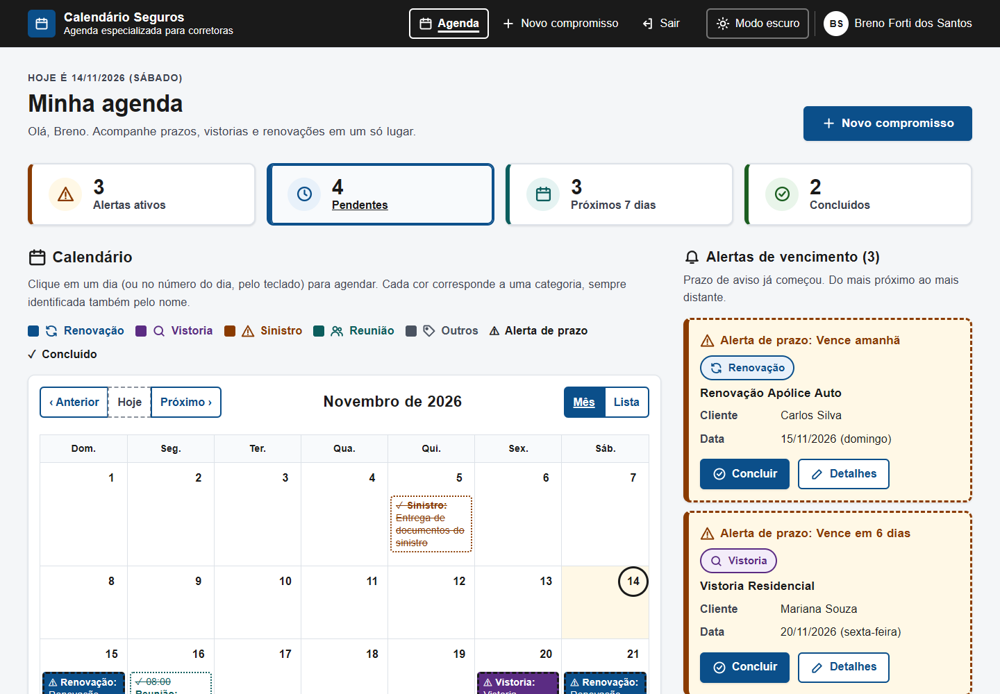
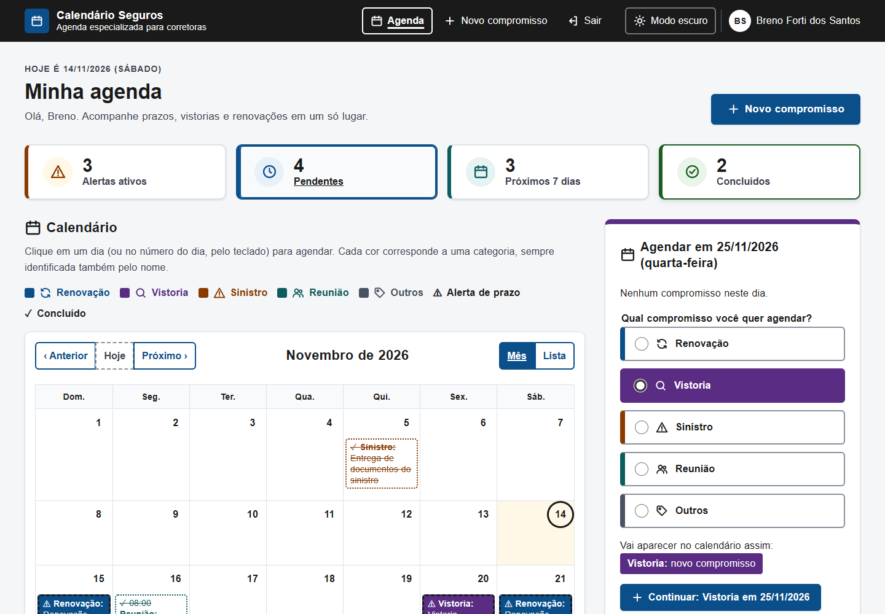
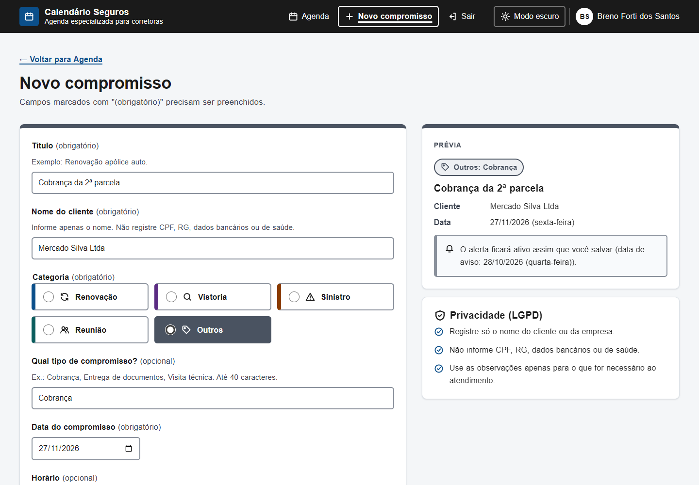
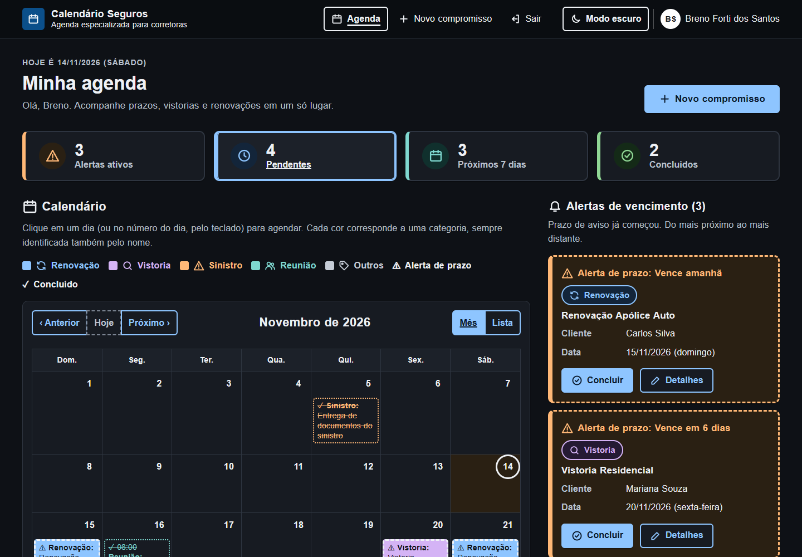
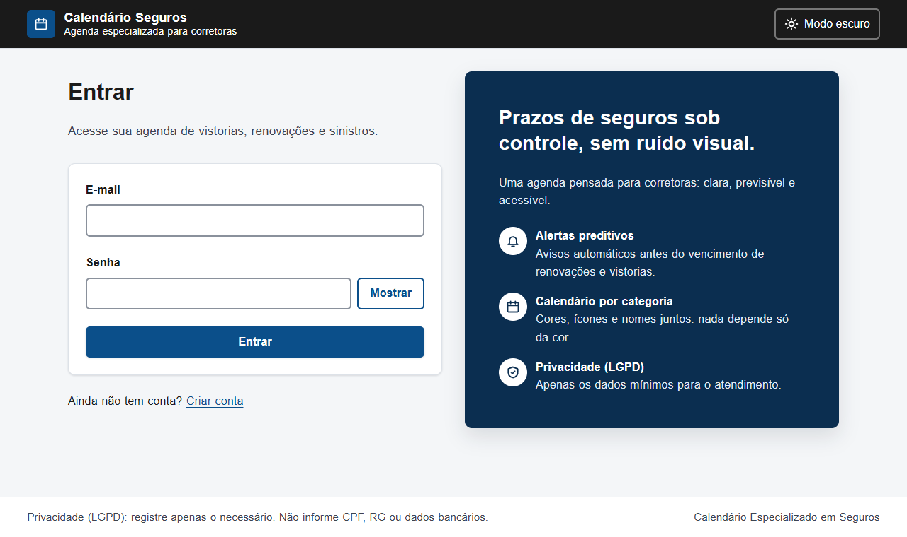
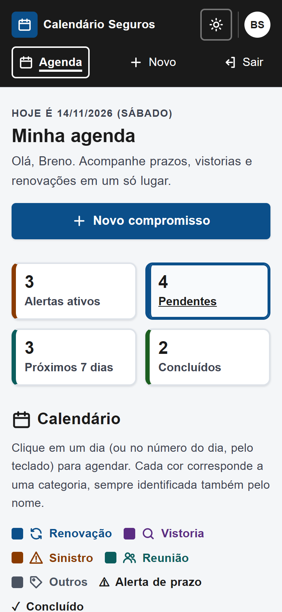
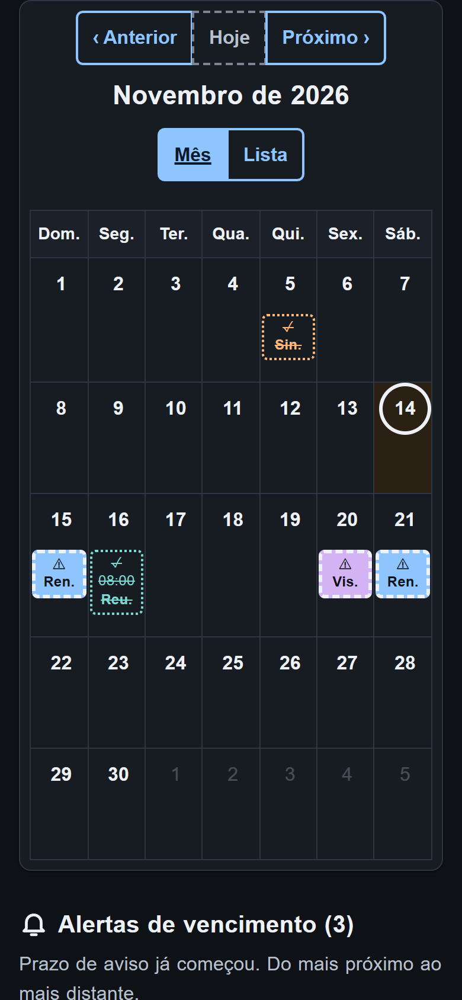
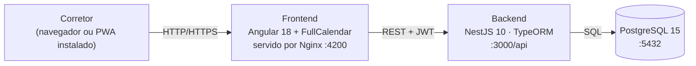

<div align="center">

# Calendário Especializado em Seguros

**Agenda acessível para corretoras de seguros — vistorias, renovações e sinistros sob controle, sem ruído visual.**




</div>

---

## Sumário

- [Sobre o projeto](#sobre-o-projeto)
- [Funcionalidades](#funcionalidades)
- [Acessibilidade e neuroinclusão](#acessibilidade-e-neuroinclusão)
- [Capturas de tela](#capturas-de-tela)
- [Arquitetura](#arquitetura)
- [Como executar](#como-executar)
- [API REST](#api-rest)
- [Segurança e LGPD](#segurança-e-lgpd)
- [Estrutura do projeto](#estrutura-do-projeto)
- [Metodologia de validação](#metodologia-de-validação)
- [Próximos passos](#próximos-passos)
- [Licença e privacidade](#licença-e-privacidade)

---

## Sobre o projeto

O **Calendário Especializado em Seguros** é uma aplicação web progressiva (PWA), desenvolvida com abordagem **mobile-first**, para a gestão de agendamentos, vistorias e renovações de apólices em corretoras de seguros.

O sistema foi concebido para **reduzir falhas operacionais causadas pela perda de prazos críticos** e para **remover barreiras de acessibilidade visual e cognitiva** no ambiente de trabalho. As diretrizes de design seguem a **WCAG 2.1 nível AA** e os **Objetivos de Desenvolvimento Sustentável da ONU (ODS 8 — metas 8.2 e 8.5)**, promovendo a neuroinclusão de profissionais autistas (nível 1 de suporte) e de pessoas com daltonismo.

---

## Funcionalidades

### Agenda e calendário
- **Calendário mensal interativo** (FullCalendar): clique em um dia — ou ative o número do dia pelo teclado — para agendar ali mesmo.
- **Escolha do tipo com cor dinâmica**: ao selecionar Renovação, Vistoria, Sinistro, Reunião ou **Outros**, o painel muda para a cor da categoria e mostra uma prévia de como o evento aparecerá.
- **Categoria "Outros" personalizável**: o corretor informa o tipo (ex.: *Cobrança*, *Entrega de documentos*), exibido como "Outros: Cobrança".
- **Visões Mês e Lista**, com navegação entre meses.
- **Cartões de resumo clicáveis** — Alertas ativos, Pendentes, Próximos 7 dias e Concluídos — que filtram a lista de compromissos.

### Alertas preditivos
- A **data de alerta é calculada automaticamente** (`data do compromisso − dias de antecedência`) e recalculada a cada edição.
- **Painel de alertas de vencimento** com tripla codificação: ícone ⚠, borda tracejada e texto explícito ("Vence em 6 dias").
- Lista ordenada por prioridade: alertas ativos → pendentes → concluídos.

### Cadastro e acompanhamento
- **Formulário em coluna única**, com rótulos persistentes, dicas de preenchimento e **prévia ao vivo** do compromisso.
- **Validação acessível**: resumo de erros no topo com links para cada campo, mensagens em texto e foco automático.
- **Verificação de data ao concluir**: concluir um compromisso **antes** ou **depois** do dia agendado exige confirmação ("Concluir antes da data? Faltam 13 dias…") — na interface e na API.
- **Exclusão com confirmação dentro do próprio cartão**, sem pop-ups.

### Experiência
- **Modo escuro** (segue o sistema operacional ou a escolha do usuário), com contraste alto nos dois temas.
- **Responsivo de 320 px a monitores largos**: uma coluna no celular; calendário + painel lateral no desktop.
- **PWA instalável**, com suporte a telas com entalhe (notch) quando instalado.

---

## Acessibilidade e neuroinclusão

| Diretriz | Como é atendida |
|---|---|
| **Nada depende só de cor** | Toda categoria tem **cor + ícone + nome**; alertas têm ⚠ + borda tracejada + texto; concluídos têm ✓ + borda pontilhada + título riscado. |
| **Alto contraste** | Texto principal com contraste ≥ 7:1 (17:1 no tema claro); componentes com ≥ 3:1. |
| **Baixo ruído cognitivo** | Layout previsível, espaçamento generoso, fonte Arial ≥ 16 px, nenhuma animação automática, nada pisca. |
| **Movimento reduzido** | Transições apenas de cor e sombra (≤ 150 ms), desligadas com "reduzir movimento" do sistema. |
| **Sem pop-ups invasivos** | Confirmações e o painel do dia aparecem na própria página. |
| **Toque e teclado** | Alvos de toque ≥ 44 × 44 px; foco sempre visível (`3px solid #005FCC`); link "Pular para o conteúdo". |
| **Leitores de tela** | HTML semântico, `label` em todos os campos, `aria-live` para resultados de ações, foco movido para o título a cada troca de página. |
| **Textos legíveis** | Rótulos nunca são cortados nem quebrados no meio da palavra; datas por extenso ("20/11/2026 (sexta-feira)"). |

**Verificação:** durante o desenvolvimento, todas as telas foram auditadas com **axe-core (WCAG 2.1 A/AA)** em celular, tablet, notebook e monitor, nos temas claro e escuro — **zero violações** — além de uma verificação automática de quebras de texto em 13 larguras de tela (320 px a 1920 px).

---

## Capturas de tela

| Painel do dia — escolha do tipo | Formulário com prévia ao vivo |
|---|---|
|  |  |

| Modo escuro | Login |
|---|---|
|  |  |

| Celular | Celular — calendário no modo escuro |
|---|---|
|  |  |

---

## Arquitetura



| Camada | Tecnologias |
|---|---|
| **Frontend** | Angular 18 (standalone components, signals), CSS3 puro com tokens de tema, FullCalendar 6, Angular Service Worker (PWA) |
| **Backend** | NestJS 10, TypeORM 0.3, Passport JWT, bcrypt, class-validator, Helmet, Throttler |
| **Banco de dados** | PostgreSQL 15 (esquema e dados de exemplo em `database/init.sql`) |
| **Infraestrutura** | Docker Compose (3 serviços), Nginx com cabeçalhos de segurança e fallback de SPA |

### Mobile-first

O CSS parte do celular como base e acrescenta recursos com `min-width`:

| Largura | Layout |
|---|---|
| **< 360 px** | Uma coluna; cartões de resumo empilhados |
| **≥ 360 px** | Cartões de resumo em 2 colunas |
| **≥ 641 px** | Cabeçalho completo, ícones nos cartões, calendário com nomes por extenso |
| **≥ 1024 px** | Calendário + painel lateral (dia escolhido e alertas); formulário + prévia lado a lado |
| **≥ 1200 px** | 4 cartões de resumo em linha |

O texto dos eventos do calendário se adapta à largura do **próprio calendário** (container queries), e não só à largura da tela.

---

## Como executar

### Pré-requisitos
- [Docker Desktop](https://www.docker.com/products/docker-desktop/)
- [Node.js 20+](https://nodejs.org/) (apenas para desenvolvimento local)

### Opção 1 — Tudo com Docker (recomendado)

```bash
npm run docker:up
```

| Serviço | Endereço |
|---|---|
| Aplicação (PWA) | http://localhost:4200 |
| API | http://localhost:3000/api |
| PostgreSQL | `localhost:5432` |

### Opção 2 — Desenvolvimento local

```bash
docker compose up -d db     # apenas o banco
npm install                  # instala backend e frontend (workspaces)
npm run backend:dev          # API com recarga automática
npm run frontend:dev         # PWA em http://localhost:4200
```

### Usuário de teste

| E-mail | Senha |
|---|---|
| `breno@fortiseguros.com.br` | `SeguroTech2024!` |

O banco é criado com 5 compromissos fictícios (alertas ativos, uma reunião futura e um concluído). Também é possível criar uma conta pela tela de cadastro.

> **Recriar o banco do zero:** o `database/init.sql` só é executado quando o volume é criado.
> ```bash
> docker compose down -v && docker compose up -d --build
> ```

### Variáveis de ambiente (backend)

Veja `backend/.env.example`.

| Variável | Descrição | Padrão |
|---|---|---|
| `PORT` | Porta da API | `3000` |
| `DATABASE_HOST` / `DATABASE_PORT` | Endereço do PostgreSQL | `localhost` / `5432` |
| `DATABASE_USER` / `DATABASE_PASSWORD` / `DATABASE_NAME` | Credenciais do banco | ver `.env.example` |
| `JWT_SECRET` | Chave de assinatura dos tokens | **defina uma chave forte em produção** |
| `APP_TIMEZONE` | Fuso usado para calcular "hoje" nos alertas | `America/Sao_Paulo` |

---

## API REST

Base: `http://localhost:3000/api`. Todas as rotas de `/eventos` exigem o cabeçalho `Authorization: Bearer <token>`.

| Método | Rota | Descrição |
|---|---|---|
| `POST` | `/auth/register` | Cria uma conta e retorna o token |
| `POST` | `/auth/login` | Autentica (limite: 5 tentativas por minuto) |
| `GET` | `/auth/profile` | Dados do usuário autenticado |
| `GET` | `/eventos` | Lista por prioridade; filtros: `category`, `isCompleted`, `startDate`, `endDate` |
| `GET` | `/eventos/alertas` | Pendentes cujo alerta preditivo já disparou |
| `GET` | `/eventos/:id` | Detalhe (404 se não existe; 403 se pertence a outro usuário) |
| `POST` | `/eventos` | Cria; ícone e rótulo são atribuídos pela categoria |
| `PUT` | `/eventos/:id` | Edita e recalcula a data de alerta |
| `PATCH` | `/eventos/:id/concluir` | Conclui; fora da data agendada exige `{ "confirmarForaDaData": true }` (senão, 422) |
| `DELETE` | `/eventos/:id` | Exclui |

**Categorias:** `Renewal` (Renovação), `Inspection` (Vistoria), `Claim` (Sinistro), `Meeting` (Reunião) e `Other` (Outros — aceita `accessibleLabel` com o tipo personalizado).

<details>
<summary>Exemplo: criar um compromisso</summary>

```http
POST /api/eventos
Authorization: Bearer <token>
Content-Type: application/json

{
  "title": "Vistoria Auto",
  "clientName": "João Pereira",
  "category": "Inspection",
  "appointmentDate": "2026-12-10",
  "appointmentTime": "14:00",
  "alertLeadDays": 30
}
```

Resposta `201`: o compromisso com `accessibleIcon: "pi-search"`, `accessibleLabel: "Vistoria"` e `alertTriggerDate: "2026-11-10"`.
</details>

---

## Segurança e LGPD

- **Autenticação** com JWT (validade de 8 h) e senhas com **bcrypt (custo 12)**; mensagens de erro genéricas para não revelar quais e-mails existem.
- **Controle de acesso por dono do registro** (OWASP A01): cada usuário só lê, edita, conclui ou exclui os próprios compromissos.
- **Validação estrita de entrada**: campos não previstos são rejeitados (ex.: tentar enviar `cpf` resulta em erro 400).
- **Proteção contra força bruta**: limite de tentativas de login e de requisições por minuto.
- **Cabeçalhos de segurança** com Helmet (API) e Content-Security-Policy no Nginx (frontend); CORS restrito à origem do app.
- **Erros sem detalhes internos**: um filtro global evita expor stack traces.
- **Minimização de dados (LGPD)**: apenas o nome do cliente e os dados operacionais do compromisso — sem CPF, RG ou dados bancários. O service worker **não guarda dados da API** no aparelho.

---

## Estrutura do projeto

```
calendario-especializado-seguros/
├── backend/                  # API NestJS
│   └── src/
│       ├── appointments/     # compromissos, alertas, categorias, DTOs
│       ├── auth/             # login, cadastro, JWT
│       ├── users/            # usuários
│       └── common/           # filtro global de exceções
├── frontend/                 # PWA Angular
│   ├── public/               # manifest, ícones, script de tema
│   └── src/app/
│       ├── core/             # serviços, modelos, autenticação, tema
│       ├── pages/            # login, cadastro, agenda, formulário
│       └── shared/           # calendário, cartão, selo de categoria, ícones
├── database/init.sql         # esquema e dados de exemplo
├── docs/screenshots/         # imagens deste README
└── docker-compose.yml        # db + backend + frontend
```

---

## Metodologia de validação

A interface é submetida a protocolos de teste de usabilidade baseados em tarefas operacionais reais, medindo:

- **Eficácia:** taxa de conclusão de tarefas sem necessidade de assistência.
- **Eficiência:** tempo, em segundos, para executar os fluxos centrais (agendar, concluir, consultar alertas).
- **Satisfação:** avaliação padronizada de facilidade de uso e clareza visual, em escala ordinal.

---

## Próximos passos

- [ ] Versionar no repositório os testes automatizados (API, interface e acessibilidade) e executá-los em integração contínua.
- [ ] Retirar credenciais e `JWT_SECRET` do `docker-compose.yml`, usando variáveis de ambiente/segredos.
- [ ] Sessão com cookie `httpOnly` e renovação de token.
- [ ] Notificações push dos alertas preditivos pelo PWA.
- [ ] Compromissos recorrentes e exportação para calendários externos (`.ics`).

---

## Licença e privacidade

Projeto de uso restrito (**UNLICENSED**). Segue diretrizes estritas de privacidade (LGPD): todas as etapas de teste e prototipagem utilizam **dados fictícios**.
